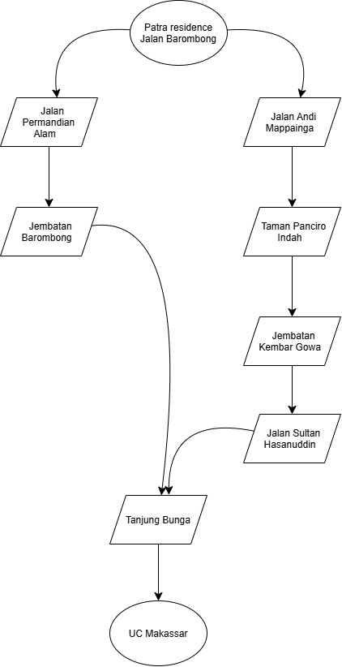

# Graph Search: Patra Residence to UC Makassar

Python implementation of GRAPH-SEARCH (BFS and DFS) on an unweighted graph of my route from Patra Residence (Barombong) to UC Makassar.

## Files & Classes

- `afl1.py`: `Node`, `StackFrontier` (LIFO), `QueueFrontier` (FIFO), `graph_search`, and the route graph.

## How to run

```
python afl1.py
```

It prints the solution path and the expanded nodes for BFS and DFS.

## Rules followed

- Neighbors are expanded in alphabetical order (for DFS they are pushed in reverse, so the smallest is popped first).
- Goal test happens when a node is removed from the frontier.
- A child is not added if its state is already in the frontier or the explored set.
- The explored set is a Python `set`.

## Graph



Two routes from Patra Residence that merge at Tanjung Bunga:

- Short: Patra Residence > Jalan Permandian Alam > Jembatan Barombong > Tanjung Bunga > UC Makassar
- Long: Patra Residence > Jalan Andi Mappainga > Jembatan Panciro Indah > Jembatan Kembar Gowa > Jalan Sultan Alauddin > Tanjung Bunga > UC Makassar

## Results

| | Path | Expanded nodes |
|---|---|---|
| BFS | Patra Residence, Jalan Permandian Alam, Jembatan Barombong, Tanjung Bunga, UC Makassar | Patra Residence, Jalan Andi Mappainga, Jembatan Barombong, Taman Panciro Indah, Tanjung Bunga, Jembatan Kembar Gowa, Jalan Sultan Alauddin |
| DFS | Patra Residence, Jalan Andi Mappainga, Taman Panciro Indah, Jembatan Kembar Gowa, Jalan Sultan Alauddin, Tanjung Bunga, UC Makassar | Patra Residence, Jalan Andi Mappainga, Taman Panciro Indah, Jembatan Kembar Gowa, Jalan Sultan Alauddin, Tanjung Bunga |

BFS returns the short route because it always finds the path with the fewest edges. DFS goes deep along the first branch it picks and returns the long route, so it is not optimal.

## Analysis

**(1) Why is the explored set a set and not a list?**

For every neighbor of every expanded node, the search has to check whether that state was already explored. A set does this check in O(1) on average because it uses hashing. A list has to scan its elements one by one, which is O(n), and that cost grows as the explored list grows. A set also ignores duplicates automatically. The trade-off is that a set has no order, so the expansion order is stored in a separate list (`order`).
